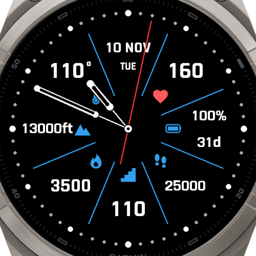

# DataDial

Analog Connect IQ watch face for the Garmin fēnix 9 Pro 51mm (466×466 AMOLED).



*Simulator screenshot of the test build (`./build.sh test`), which shows fixed worst-case values to check the layout: 25,000 steps (60% of goal), 110 floors (goal met), 3,500 calories, heart rate 160, 13,000 ft, 110° (hot), 100% battery with 31 days left. Its clock is fixed at 12:41:26 so the hands lie along the divider lines.*

## The face

- **Dial:** a dot for every minute around the display edge, larger at the hours and
  largest at 12, 3, 6 and 9.
- **Hands:** hollow hour and minute hands on thin stems, an open center hub, and a red
  seconds hand while the watch is awake. The minute hand moves every 10 seconds and the
  hour hand every 10 minutes.
- **Stats:** eight sections divided by colored lines (blue by default), each with an icon
  in the same color toward the center and a white value toward the edge. The heart rate
  icon has its own color (red by default). Short values (heart rate, floors, temperature,
  calories) use larger text. Clockwise from 12:

| Section | Shows | Read |
|---|---|---|
| 12 o'clock | Date, weekday underneath | On wake-up and when midnight passes |
| 1:30 | Heart rate | Every second |
| 3 o'clock | Battery %, with the watch's own estimate of days left underneath (hours under a day) | Once a minute; every second while charging |
| 4:30 | Steps | Every 3 seconds |
| 6 o'clock | Calories | Every 10 seconds |
| 7:30 | Floors climbed | Every 10 seconds |
| 9 o'clock | Elevation | Every 10 seconds |
| 10:30 | Temperature | Every 10 seconds |

Everything is also re-read each time the watch wakes. A value that isn't available
shows as `--`. Elevation and temperature follow the watch's unit settings (ft/m, °F/°C).

- **Battery:** the icon fills to the charge level. Below 20% the icon and percentage turn
  red. While charging, a green lightning bolt appears over the icon.
- **Goals (steps and floors):** each has a curved gauge along the outer edge of its cell,
  filling from its lower end upward (steps left to right, floors right to left) toward the
  daily goal set on the watch. The fill is red below 30% of the goal, yellow below 90%, and
  green from 90%. Once the goal is met, the value turns green too. With no goal set, there
  is no gauge. Calories has no goal, since the watch doesn't expose one to watch faces.
- **Temperature:** below 40 °F (4.4 °C) the value turns ice blue with a snowflake above it;
  above 90 °F (32.2 °C) it turns red with rising heat waves above it.
- **Always-on mode:** if always-on display is enabled, the sleeping watch shows the dot
  dial and the hour and minute hands in dim gray, with no stats or seconds hand. Everything
  shifts by up to 2 px each minute to prevent burn-in. The simulator's 24-hour burn-in check
  reports no burn-in, at about 1% luminance.

## Settings

In the Connect IQ or Garmin Connect phone app, under DataDial's settings:

| Setting | Colors | Default |
|---|---|---|
| Lines and icons color | Divider lines, stat icons and the battery outline | Blue |
| Heart rate icon color | Heart icon only | Red |

Each offers Blue, Cyan, Green, Yellow, Orange, Red, Pink, Purple, White and Gray. The
icons are stored white and tinted as they're drawn. Warning colors stay fixed: low battery
red, charging green, the goal colors, and the cold and hot temperature colors.

Phone settings only reach a copy installed from the Connect IQ Store (or uploaded there as
a beta app). A `.prg` copied over USB always uses the defaults. In the simulator, change
them with File → Edit Persistent Storage → Edit Application.Properties data (Ctrl+P), then
Save. `./build.sh run` and `./build.sh test` send the settings file the simulator needs
for that window; without it, the window says the app has no settings.

All sizes and positions are relative to the screen radius, so other round displays only
need to be added to `manifest.xml`.

## Power

- The dots, divider lines and icons are drawn once, into an off-screen image.
- The stat values and goal gauges are drawn into a second image, and only the stat whose
  value changed is redrawn.
- Each frame copies that image to the screen and draws the hands on top.

Before the goal gauges and temperature symbols were added, this took about 31 ms per
frame in the simulator while awake, against 45 ms for the first, much simpler version of
the face. The new parts are only redrawn when their values change, but they haven't been
profiled. All of these are PC timings, useful for comparing versions, not as watch timings.

## Files

| File | Purpose |
|---|---|
| `manifest.xml` | App id, target products, `SensorHistory` permission |
| `source/DataDialApp.mc` | Application entry point |
| `source/DataDialView.mc` | Drawing, refresh schedule, cached images, always-on view |
| `source/Metrics.mc` | Reads and formats each value |
| `source/TestValues.mc` | Fixed values and clock time for the test build; does nothing in the normal build |
| `resources/drawables/` | Stat icons (white SVG masks, stored as PNG for smooth edges) |
| `resources/settings/` | Color settings: properties and the phone-app settings page |
| `tools/PushSettings.java` | Sends the settings file to the simulator (used by `build.sh`) |
| `monkey.jungle` | Normal build |
| `monkey.test.jungle` | Test build with fixed values |

## Build

Requires Connect IQ SDK 9.3.0 and the developer key at `../developer_key`.

```sh
./build.sh          # build bin/DataDial.prg
./build.sh run      # build, start the simulator, load the face
./build.sh test     # test build with fixed worst-case values and time, in the simulator
```

The test build goes to `bin/DataDial-test.prg`. Don't copy that one to the watch.

`build.sh` uses the Java runtime bundled with STM32CubeMX unless `JAVA_HOME` is set.

## Install on the watch

1. Build with `./build.sh`. The `.prg` runs on the watch, not only in the simulator.
2. Connect the watch over USB. It shows up in File Explorer as a portable device.
3. Copy `bin/DataDial.prg` into `GARMIN\Apps` on the watch.
4. Unplug, then choose DataDial in the watch's list of watch faces.

## Notes

- Temperature comes from the watch's own sensor, so it reads high while worn. The cold and
  hot thresholds apply to that reading, not to the weather.
- Heart rate is the live reading when available, otherwise the latest history sample.
- The battery estimate is the same number the watch shows under Power Manager → Battery
  Estimates.
- Battery Saver mode can swap DataDial for a simpler watch face if its **Watch face**
  option is enabled.
